# Feature Workflow — diagrams first

> **Ratified 2026-11-07 · advisory.** Invoked deliberately (`/feature SC-131`),
> never automatic. Not for typo, copy, colour, or chore changes. See
> [README](./README.md) for the ratification format.

**The design is the diagrams.** Text exists to explain what a diagram cannot
show: the use case narrative, the invariants, the open questions, the deltas.
Everything else is a caption.

## Invoke

```text
/feature SC-131                      # or: @tahirs-feature-workflow SC-131
```

Then, after you approve the design:

```text
Design approved. Implement with TDD, review to convergence, merge, deploy to
dev.tahirslist.com and verify. Report evidence, not assurances.
```

## The pipeline

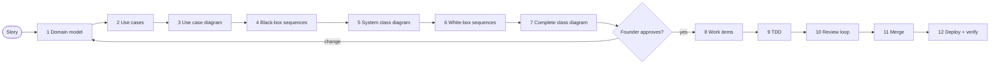

Two human checkpoints only: **design approval** (7 → 8) and **deploy
acceptance** (12). Everything between is the agent's job, self-checked.

## Rules of the road

1. **Diagrams over prose.** Outside tables, diagrams, and use case narratives, an
   artifact should read in under a minute.
2. **One screen per diagram.** Split rather than shrink.
3. **Black box out, white box in.** Phase 4 names no internals; Phase 6 names
   nothing else.
4. **No invented classes.** A white-box participant must exist in Phase 5. If it
   doesn't, fix Phase 5 first and record the delta.
5. **No invented requirements.** The story and ACs come from Shortcut; open
   product questions go to the founder, not into the design.
6. **Every PR traces to a use case step**, and every merged PR is verified on dev.
7. **Review the diagram, then the delta table.** Prose is reviewed only where the
   diagram is silent.
8. **Actors left, data stores right.** Sequence diagrams put everything outside
   the system on the left; owned data stores sit on the far right. See
   [Diagram conventions](#diagram-conventions).

### Diagram conventions

**Sequence diagrams: actors on the left.** Anything outside our system — the
user, an agent client, Google Places, Photon, Yelp, Gemini — is an actor and sits
on the left. Our lifelines follow in call order, so a call to an actor points
**left**. A black-box diagram keeps one "Tahir's List" lifeline and puts every
external service to its left as well.

**Draw the symbol, not just the position.** Declare actors with Mermaid's `actor`
keyword so they render as stick figures; `participant` renders a plain rectangle
and hides that the box is outside our control.

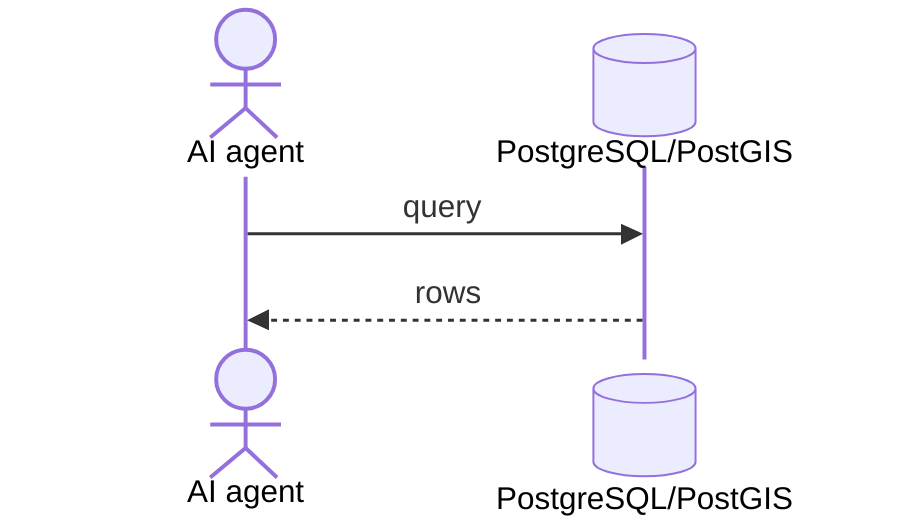

**Our data stores sit on the far right.** PostgreSQL/PostGIS, MinIO/S3 and other
owned infrastructure come after the internal lifelines. Give them the database
symbol (`participant DB@{ "type": "database" }`; flowcharts use the `[(...)]`
shape) — not a rectangle, which reads as another service. A white-box sequence
must show the actual read/write against the store (SQL or object call); it may not
stop at the repository interface. Data never arrives by magic.

**White-box shows the concrete adapter and its outbound call.** For every
external dependency, draw adapter → external system → adapter, with the failure
branch (no match vs provider outage).

## Artifacts

```
docs/features/<STORY-ID>/
  00-story.md              01-domain-model.md          02-use-cases.md
  03-use-case-diagram.md   04-blackbox/UC-xx-*.md      05-class-diagram-system.md
  06-whitebox/UC-xx-*.md   07-class-diagram-complete.md 08-design-walkthrough.md
  09-work-items.md         10-traceability.md
```

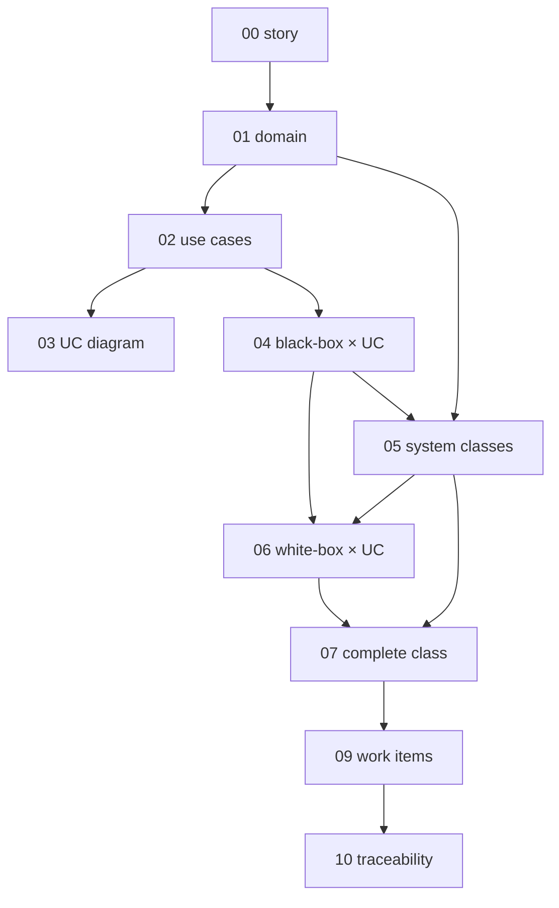

**Change a node → redraw everything downstream.** That arrow is the whole reason
the order matters.

**Every artifact opens with one header line**, so a reviewer knows what to look
at and what changed:

```markdown
> **Purpose:** why this file exists · **Derived from:** 01, 02 · **Delta:** new UC-04
```

## Phase 0 — Story

`00-story.md`: Shortcut link, story ID, epic + iteration, priority, personas,
**verbatim** ACs, edge cases, open questions with owners. Nothing invented, nothing
paraphrased.

## Phase 1 — Domain model

`01-domain-model.md`: one Mermaid `classDiagram` plus three tables.

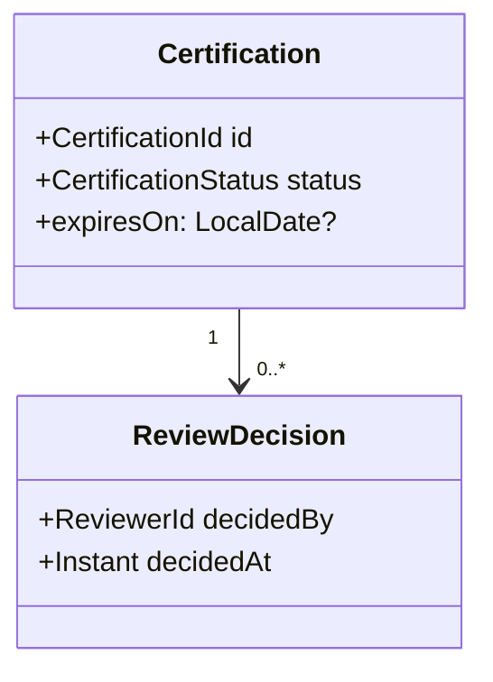

- **Invariants** — `| # | Invariant | Becomes test |` (each row a future test name).
- **States** — `| From | Event | To | Guard |` for anything with a lifecycle.
- **Glossary** — `| Term | Meaning |` only for terms the use cases use.

No tables, columns, HTTP, or framework names. State the `ARCHITECTURE.md` §1.2
impact in one line: *none / extends / changes*.

## Phase 2 — Use cases

`02-use-cases.md`, one section per `UC-xx`. This is the one place text leads:

```
Actors · Goal · Trigger · Preconditions
1..n  main success scenario
A1..  alternates        E1..  exceptions → resulting state
Postconditions · Data · ACs · Open questions
```

One use case per actor goal — not per screen, not per endpoint. An unresolved
product question becomes a numbered decision item for the walkthrough.

## Phase 3 — Use case diagram

`03-use-case-diagram.md`: this feature's use cases **and** the updated
system-wide diagram. Mark **new** vs **existing**.

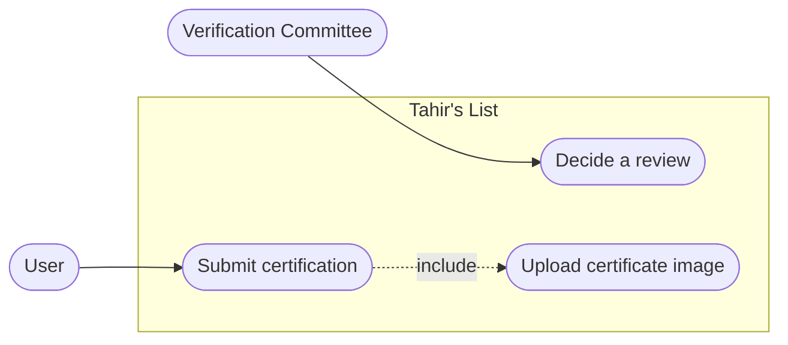

Actor→use case means "may initiate", not "benefits from". Reachable-only-through
use cases get `«include»`, not a top-level arrow.

## Phase 4 — Black-box sequences

`04-blackbox/UC-xx-<slug>.md`, **one per use case**. Actor + one "Tahir's List"
lifeline + opaque externals. Main scenario, then one fragment per alternate and
exception flow.

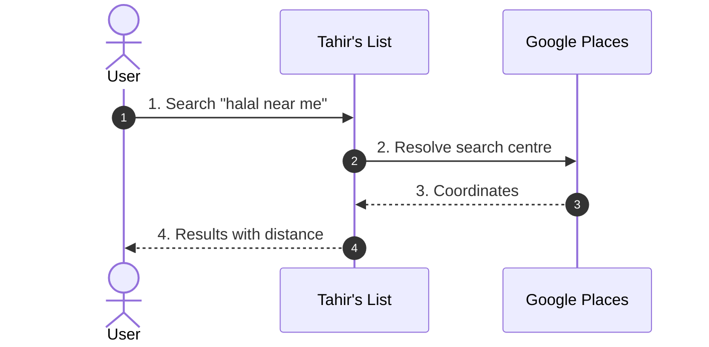

Number messages to match the use case steps. **No class, port, table, or method
names** — if a step needs one to be explained, Phase 2 is underspecified.
Security-relevant flows (auth, uploads, trust, PII) get a `> **Security:**` line
in the header. Actor lifelines sit on the left; external services are actors too
(see [Diagram conventions](#diagram-conventions)).

## Phase 5 — System class diagram

`05-class-diagram-system.md`: three sub-diagrams plus one overview.

| Sub-diagram | Contains |
|---|---|
| **domain** | entities + value objects from Phase 1, invariants as operations |
| **application** | exactly one control class per use case, ports as interfaces |
| **boundary** | the API surface each actor talks to |

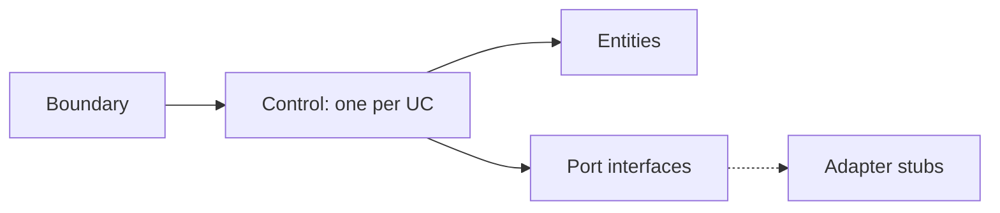

No tables, no JSON, no framework annotations — those are Phase 7. Every use case
step must resolve to an operation here.

## Phase 6 — White-box sequences

`06-whitebox/UC-xx-<slug>.md`, **1:1 with Phase 4**. Only classes and interfaces
from Phase 5, each message annotated with the operation it calls.

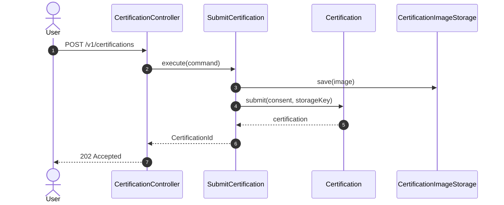

Every diagram must show: **transaction boundary**, aggregate state transition,
authorization point (identity from the token, never the client), and the concrete
error each exception flow becomes. Actors sit on the left, owned data stores on
the far right; show the adapter's outbound call and the actual store read/write.
A missing class means a Phase 5 fix + delta.

## Phase 7 — Complete class diagram

`07-class-diagram-complete.md`: the layer map, then three delta tables.

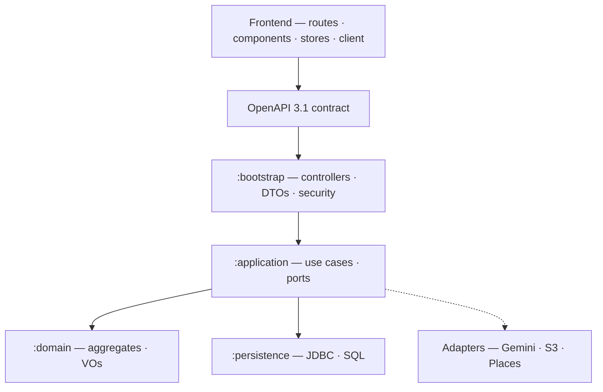

| Delta table | One row per… |
|---|---|
| **Persistence** | table, column, constraint, index, migration name |
| **API** | endpoint, shape, error code, OpenAPI change |
| **Frontend** | route, component, store, client call → endpoint |

Mark each row **new / modified / unchanged**. Names are final here. Naming
arguments happen now, not in code review.

## Phase 8 — Walkthrough and approval

`08-design-walkthrough.md` is **one section per diagram, three bullets each**:

```markdown
## 4. Black-box sequences
**Shows:** what the actor sees, flow by flow.
**Locks in:** the visible behavior and the external calls.
**Need:** approve — or pick A vs B for the expiry flow (recommend A).
```

Then the decision table, then the ask:

| Founder says | Agent does |
|---|---|
| `approved` | record approval, go to Phase 9 |
| a diagram change | re-run that phase, redraw downstream, re-ask |
| a new requirement | stop — Shortcut first, then re-design |
| nothing on a question | it stays open; no silent decision |

```markdown
## Approval
Approved by: founder · Date: 2026-11-XX · Design commit: <sha>
Decision items: D-1 … D-n resolved as tabled
```

**No implementation code before this line exists.**

## Phase 9 — Work items

`09-work-items.md`: backend first, then frontend after the contract lands.

```markdown
| WI | Layer | Covers | Tests first | Depends on | PR |
|----|-------|--------|-------------|------------|----|
| 01 | be | UC-02.1–3 | `SubmitCertificationTest.rejectsExpired` | — | 1 PR |
```

Full per-item template in [Appendix B](#appendix-b--work-item). Two-way coverage:
every use case step has a WI; every Phase 7 class belongs to exactly one.

## Phase 10 — Implementation

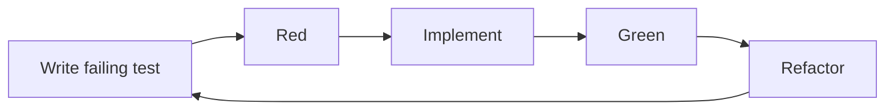

Branch `feat/<STORY>-<slug>`. Formatter before every commit, `[SC-###]` prefix,
green build only. PR body from Appendix C. Update `10-traceability.md` with the PR
number immediately.

## Phase 11 — Review to convergence

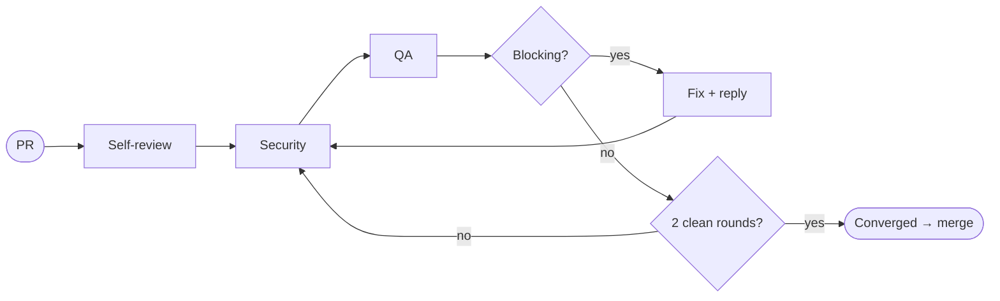

**Blocking:** wrong behavior, unmet AC, security, missing test, diagram
divergence, red build, undocumented API/DB change.
**Non-blocking:** `nit:` / `optional:`.

Converged when all of these hold:

1. zero unresolved blocking threads;
2. every AC proven by a test or recorded manual evidence;
3. traceability complete, named tests pass;
4. full containerized suites green on the head;
5. an attributed `Verdict: APPROVE` recorded;
6. **two consecutive rounds with zero new blocking findings**;
7. no behavior change without a diagram update;
8. deferrals exist as Shortcut stories, not TODOs.

Three rounds without convergence → escalate with a one-paragraph summary and a
proposed resolution. Never split the difference on a security finding.

## Phase 12 — Merge and deploy

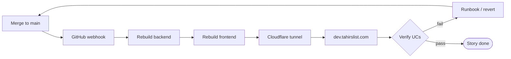

The deploy scripts live **outside this repo**; there is **no CI**. "Green" means
the containerized suites were run and the output recorded. Verify on dev:

```
[ ] dev returns 200, backend health UP
[ ] every in-scope UC main flow exercised on dev
[ ] one exception path exercised
[ ] no new log errors, migration applied
[ ] uploads/auth re-checked if touched
[ ] evidence recorded in 10-traceability.md
[ ] story Done; follow-ups are stories
```

**Known risk:** the external deploy scripts predate SvelteKit (`node:22`, `npm`,
port 3000). Confirm the deployed frontend is the current build; if not, fixing the
deploy path is part of this phase. Roll back by reverting the merge commit via a
PR — never force-push.

## Traceability

```markdown
| AC | UC | Black-box | White-box | Classes | Tests | WI | PR | Deployed |
|----|----|-----------|-----------|---------|-------|----|----|----------|
| AC-1 | UC-01 | 04/UC-01 | 06/UC-01 | `Certification` | `SubmitCertificationTest` | 03 | #142 | ✅ |
```

Empty cell = finding, not formatting.

## Change sizes

| Change | Phases |
|---|---|
| New feature | 0–12 |
| Behavior change | 1–7, 8 approval, 9–12 |
| Defect fix | 10–12 (regression test first) |
| Docs / chores | PR + review + deploy check |
| Emergency | minimal fix + test, full write-up in 2 days |

Not invoking the workflow at all is a valid choice for the bottom two rows.

## Amend

PR this file + founder approval, `status: proposed` while in review, bump
`ratified.on` on merge.

---

## Appendix A — Use case

```markdown
### UC-01 — <actor outcome>

- **Primary actor:** U | RO | VRO | VC | IC | ET
- **Supporting:** … · **Goal:** … · **Trigger:** …
- **Preconditions:** …
- **Business rules:** BR-1 …

**Main success scenario**
1. …
2. …

**Alternate flows** — A1 (from 2): …
**Exception flows** — E1 (from 3): … → resulting state

- **Postconditions:** success … / failure …
- **Data:** created / read / updated
- **ACs:** AC-2 · **Open:** Q-1 (owner)
```

## Appendix B — Work item

```markdown
### WI-03 — <title>
- **Layer:** backend | frontend · **Covers:** UC-01.2–4, UC-01.E1
- **Classes:** `SubmitCertification`, `Certification`, `CertificationRepository`
- **Tests first:** `…Test.rejectsExpiredCertificate()`
- **ACs:** … · **Depends on:** WI-02
- **PR scope:** one PR · **Risk:** low | medium | high
- **Review focus:** security? / runtime QA?
```

## Appendix C — PR body

```markdown
<!-- attribution: hamza -->
Author: hamza
Story: SC-131 · WI: 03 · Design: 07-class-diagram-complete.md (approved <date>)
Use cases: UC-02 (04/UC-02, 06/UC-02)

## What changed
- …

## Evidence
- `./scripts/backend-test.sh` → green (N tests)
- `./scripts/frontend-test.sh` → green

## Security / QA
- attack: … · exercise: …

## Diagrams
- [ ] updated if behavior changed
```

## Appendix D — Pre-implementation checklist

```
[ ] 00 story: ACs verbatim, open questions owned
[ ] 01 domain: diagram + invariants + states + glossary, ARCHITECTURE line
[ ] 02 use cases: every AC mapped, every flow ends in a state
[ ] 03 UC diagram: 1:1, new/existing marked
[ ] 04 black-box: one per UC, no internal names
[ ] 05 system classes: every UC step → an operation
[ ] 06 white-box: 1:1, no invented classes, tx/authz/errors shown
[ ] 07 complete: layer map + persistence/API/frontend deltas
[ ] 08 walkthrough: 3 bullets per diagram + decisions + approval line
[ ] 09 work items: two-way coverage, tests named
[ ] 10 traceability: open and current
```

## Appendix E — Prose budget

An artifact fails review if, outside its diagrams, tables, and use case narrative,
it takes more than a minute to read. Symptoms:

| Symptom | Fix |
|---|---|
| paragraph explaining a class | put the class in the diagram |
| paragraph explaining a flow | draw the sequence |
| paragraph listing fields | make it a delta table |
| "see above" / repeated context | delete it — the header carries it |

## Appendix F — Walkthrough template

```markdown
# Design walkthrough — SC-XXX <title>
Design commit: <sha> · Date: <date>

## 1. Story + domain model
**Shows:** … **Locks in:** … **Need:** approve
## 2. Use cases
**Shows:** UC-01…n **Locks in:** … **Need:** decide D-1, D-2
## 3. Use case diagram · 4. Black-box · 5. System classes · 6. White-box
(three bullets each)
## 7. Complete class diagram — the design being approved
**Shows:** layers, migrations, API delta, frontend tree
**Locks in:** module boundaries, table/API shapes, naming
**Need:** approve / name the change

| # | Question | Recommendation | Decision |
|---|----------|----------------|----------|
| D-1 | … | … | <pending> |

## Approval
Approved by: <pending> · Date: · Design commit:
```
